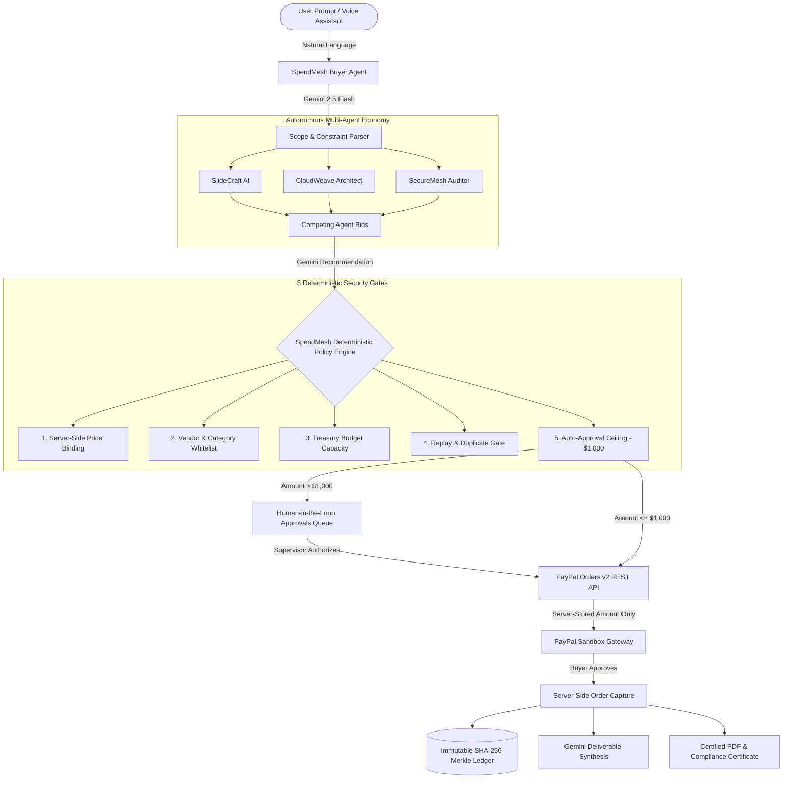

# SpendMesh AI

[](#testing)
[](#testing)
[](LICENSE)
[](https://nodejs.org)
[](https://developer.paypal.com)
[](https://aistudio.google.com)

---

## 2. Tagline
> **The deterministic financial trust layer that stops autonomous AI agents from overspending your budget.**

---

## 3. Problem Statement

As autonomous AI agents evolve from conversational bots into economic actors capable of procuring services, computing resources, and contracting vendors, a fundamental security challenge arises: **How can enterprises safely delegate purchasing power to autonomous agents without granting them unconstrained access to financial instruments?**

Giving an AI agent direct credit card credentials or unchecked checkout authority creates catastrophic exposure:
- **Non-deterministic hallucinations** can lead to unauthorized high-value purchases.
- **Prompt injection attacks** can manipulate price parameters during execution.
- **Rogue loop conditions** can drain an entire company treasury within seconds.

**SpendMesh AI** bridges this critical gap by introducing a strict, zero-trust financial policy perimeter between autonomous agent negotiations and payment gateways like PayPal. No agent can bypass deterministic spending policies, tamper with agreed amounts, or exceed cumulative budget thresholds.

---

## 4. System Architecture



---

## 5. Live Production Deployments

- **Frontend Application (Vercel):** [https://spendmesh-ai.vercel.app](https://spendmesh-ai.vercel.app)
- **Backend API (Render):** [https://spendmesh-ai-api.onrender.com](https://spendmesh-ai-api.onrender.com)
- **API Health Check:** [https://spendmesh-ai-api.onrender.com/api/health](https://spendmesh-ai-api.onrender.com/api/health)

---

## 6. PayPal Sandbox Demo Credentials

When completing the test checkout on PayPal's sandbox gateway, use your PayPal Developer Sandbox Personal Buyer account:
- **Buyer Test Email:** `sb-buyer@business.example.com` *(or any Sandbox Personal Account from developer.paypal.com)*
- **Buyer Test Password:** *(From your PayPal Developer Dashboard > Testing Tools > Sandbox Accounts)*

> *Note: These credentials belong exclusively to the PayPal Developer Sandbox environment. No real money or live payment method is ever charged.*

---

## 6.1 Interactive One-Click Test Scenarios (on `/requests`)

Judges can instantly test the 4 core financial guardrails via the top scenario buttons:
1. **1. Standard Purchase ($400):** Gemini extracts scope &rarr; 3 seller bids evaluated &rarr; policy auto-approved &rarr; PayPal Sandbox checkout &rarr; deliverable unlocked & certified receipt generated.
2. **2. Price Tampering Attack:** Injects an unauthorized $800 price payload &rarr; SpendMesh detects client tampering, blocks the escalation, and enforces the authentic $400 agreed price.
3. **3. Human Approval Gate ($2,000):** Exceeds the $1,000 auto-approval threshold &rarr; quarantined to the **Approvals** queue &rarr; checkout blocked until executive sign-off.
4. **4. Duplicate Replay Attack:** Replays checkout on a settled transaction &rarr; immediately blocked with HTTP 409 Conflict.

---

## 7. Technology Stack

| Layer | Technologies | Purpose |
|---|---|---|
| **Frontend** | React 18, Vite 5, Tailwind CSS | High-performance responsive executive dashboard |
| **Backend** | Node.js (v20+), Express 5, Helmet, CORS | Zero-trust API gateway with rate limiting |
| **Database** | MongoDB Atlas, Mongoose | Atomic operations (`$inc`, `$expr`) for race-free balance reservation |
| **AI / LLM** | Google Gemini 2.5 Flash (`@google/generative-ai`) | Structured requirement parsing, bid ranking, deliverable synthesis |
| **Payments** | PayPal REST API (Orders v2 Sandbox) | Native server-to-server OAuth2 order creation & verified capture |
| **Voice Engine** | Web Speech API, Web Audio Synthesizer | Natural neural voice guidance, audio equalizers, and acoustic chimes |
| **Testing** | Jest, Supertest | 26 unit & integration tests covering policy, payments, and agents |

---

## 8. Local Setup Instructions

### Prerequisites
- Node.js version 20.0.0 or higher
- npm version 10.0.0 or higher
- A free MongoDB Atlas cluster ([mongodb.com/atlas](https://www.mongodb.com/atlas))
- A PayPal Developer account ([developer.paypal.com](https://developer.paypal.com))
- A Google Gemini API key ([aistudio.google.com](https://aistudio.google.com))

### Step-by-Step

1. **Clone the repository:**
   ```bash
   git clone https://github.com/Vinayak1806/Pay-Pal-Hackathon.git
   cd Pay-Pal-Hackathon
   ```

2. **Install all dependencies:**
   ```bash
   npm run install:all
   npm install
   ```

3. **Configure Server Environment:**
   Copy `server/.env.example` to `server/.env`:
   ```bash
   cp server/.env.example server/.env
   ```
   Fill in your credentials:
   ```env
   PORT=5000
   MONGODB_URI=mongodb+srv://<user>:<password>@cluster0.mongodb.net/spendmesh?retryWrites=true&w=majority
   PAYPAL_CLIENT_ID=your_paypal_sandbox_client_id
   PAYPAL_CLIENT_SECRET=your_paypal_sandbox_client_secret
   PAYPAL_BASE_URL=https://api-m.sandbox.paypal.com
   GEMINI_API_KEY=your_gemini_api_key
   GEMINI_MODEL=gemini-2.5-flash
   CLIENT_URL=http://localhost:5173
   ```

4. **Configure Client Environment:**
   Copy `client/.env.example` to `client/.env`:
   ```bash
   cp client/.env.example client/.env
   ```
   Contents:
   ```env
   VITE_API_URL=http://localhost:5000
   ```

5. **Start Both Applications (Frontend & Backend):**
   ```bash
   npm run dev
   ```
   - Client will run on: `http://localhost:5173`
   - Server will run on: `http://localhost:5000`

---

## 10. API Endpoint Reference Table

| Method | Endpoint | Description |
|---|---|---|
| `GET` | `/api/health` | Health check probe (Render keep-alive) |
| `POST` | `/api/agents/request` | Parses natural language task and solicits seller bids via Gemini |
| `POST` | `/api/deals` | Validates offer on server and enforces policy checks |
| `GET` | `/api/deals` | Retrieves deals list (filterable by status) |
| `GET` | `/api/deals/:id` | Retrieves a specific deal record |
| `POST` | `/api/deals/:id/approve` | Human approval/rejection of quarantined deal |
| `POST` | `/api/deals/:id/checkout` | Creates PayPal Orders v2 checkout session with server-stored amount |
| `POST` | `/api/payments/:orderId/capture` | Verifies and captures payment, releasing AI deliverable |
| `GET` | `/api/payments/cancel-status` | Reverts order state and unlocks reserved budget on user cancel |
| `GET` | `/api/policy` | Fetches user policy and live budget balances |
| `PUT` | `/api/policy` | Updates spending parameters |
| `GET` | `/api/audit` | Retrieves paginated immutable audit event records |
| `POST` | `/api/demo/reset` | Resets all test collections and restores $5,000 budget |

---

## 11. Demo Scenario Instructions

The application includes an interactive Demo Scenarios Panel accessible directly at the top of the Marketplace:

1. **Scenario 1 — Normal Purchase:**
   - Click "1. Normal Purchase" in the panel.
   - Pre-fills a $400 presentation request.
   - Evaluates bids, runs policy checks (all green), and proceeds to PayPal Sandbox checkout.
   - Captures order and reveals the synthesized presentation deliverable.
2. **Scenario 2 — Price Tampering Blocked:**
   - Click "2. Price Tampering".
   - Submits a deal for $400, but checkout injects an unauthorized body payload: `{ amount: 800 }`.
   - SpendMesh AI detects the price deviation, logs a `tamper_detected` audit event, discards the injected payload, and executes the PayPal checkout at the verified $400 amount.
3. **Scenario 3 — Human Approval Required:**
   - Click "3. Approval Required".
   - Pre-fills a $2,000 full-stack startup website request.
   - Competing bids range from $1,700–$2,000, surpassing the $1,000 autonomous threshold.
   - The Policy Engine flags `APPROVAL_REQUIRED` and routes the transaction to `/approvals` where a human reviewer can approve or reject.
4. **Scenario 4 — Duplicate Payment Blocked:**
   - Complete Scenario 1 first.
   - Click "4. Duplicate Blocked".
   - Attempts to issue duplicate checkout or re-capture on the completed deal.
   - Backend returns `HTTP 409 Conflict`, logging `duplicate_blocked` in the audit log.

---

## 12. Automated Testing

Run the comprehensive automated test suite:
```bash
npm test
```
Or directly inside the server directory:
```bash
cd server && npx jest --forceExit --detectOpenHandles
```

Output:
```
PASS tests/payments.test.js
PASS tests/deals.test.js
PASS tests/agents.test.js
PASS tests/policy.test.js

Test Suites: 4 passed, 4 total
Tests:       26 passed, 26 total
Snapshots:   0 total
Time:        0.684 s
Ran all test suites.
```

---

## 13. Vercel Deployment (Frontend)

1. Connect your GitHub repository on [Vercel](https://vercel.com).
2. Configure Project Settings:
   - **Framework Preset:** Vite
   - **Root Directory:** `client`
   - **Build Command:** `npm run build`
   - **Output Directory:** `dist`
3. Add Environment Variable:
   - `VITE_API_URL`: URL of your deployed Render backend (e.g. `https://spendmesh-api.onrender.com`)
4. Deploy!

---

## 14. Render Deployment (Backend)

1. Create a new **Web Service** on [Render](https://render.com).
2. Connect your GitHub repository.
3. Configure Service Settings:
   - **Root Directory:** `server`
   - **Environment:** `Node`
   - **Build Command:** `npm install`
   - **Start Command:** `node src/app.js`
4. Set Environment Variables:
   - `PORT`: `5000`
   - `NODE_ENV`: `production`
   - `MONGODB_URI`: Your MongoDB Atlas URI
   - `PAYPAL_CLIENT_ID`: Your PayPal sandbox client ID
   - `PAYPAL_CLIENT_SECRET`: Your PayPal sandbox client secret
   - `PAYPAL_BASE_URL`: `https://api-m.sandbox.paypal.com`
   - `GEMINI_API_KEY`: Your Google Gemini API key
   - `GEMINI_MODEL`: `gemini-1.5-flash`
   - `CLIENT_URL`: Your Vercel frontend URL
5. **Important:** The server explicitly binds to `0.0.0.0` as required for Render routing.

---

## 15. Keep-Warm Cron Setup

Render's free tier spins down idle instances after 15 minutes of inactivity. To ensure instant responses during hackathon judge reviews:
1. Register for a free account at [cron-job.org](https://cron-job.org).
2. Create a new cron job pointing to:
   `https://your-render-url.onrender.com/api/health`
3. Set schedule interval to every **10 minutes**.
4. This keeps the service warm with 200 OK responses.

---

## 16. GitHub License Setup

After creating your GitHub repository:
1. Navigate to **Settings** → **General** (or About section on repository main page).
2. Ensure the repository license is detected as **MIT License**.
3. This displays the MIT badge on the GitHub homepage, satisfying hackathon eligibility requirements.

---

## 17. Common Errors & Solutions

| Error | Root Cause | Solution |
|---|---|---|
| `FATAL: Missing required environment variables` | `server/.env` not created or missing keys | Verify all 7 required keys in `server/.env`. |
| `Failed to connect to MongoDB` | IP Access List not configured | In MongoDB Atlas, add `0.0.0.0/0` under Network Access. |
| `PayPal authentication failed` | Invalid Client ID/Secret or live endpoint used | Ensure `PAYPAL_BASE_URL=https://api-m.sandbox.paypal.com` and credentials are from Sandbox Apps. |
| `Gemini parseTask failed, using fallback` | Invalid API key or quota issue | SpendMesh AI gracefully switches to deterministic local parsing. Update `GEMINI_API_KEY`. |
| `CORS Error on frontend` | `CLIENT_URL` mismatch | Ensure `CLIENT_URL` in `server/.env` matches your Vite port (`http://localhost:5173`). |

---

## 18. Security Limitations

> **Notice:** This project is a hackathon demonstration using a hardcoded `demo-user` profile without session authentication. It is not suitable for production deployment without implementing user authentication (JWT/OAuth), role-based access control (RBAC), and verified production PayPal business accounts.

---

## 19. Sponsor Tools Attribution

- **PayPal:** Powering authentic sandbox checkout sessions and server-side capture through PayPal Orders v2 REST API.
- **Google Gemini:** Powering intelligent natural language task parsing, seller bid ranking, and structured deliverable generation with Gemini 1.5 Flash.

---

## 20. License

Released under the [MIT License](LICENSE). Copyright &copy; 2026 Vinayak Santosh Pawate.
