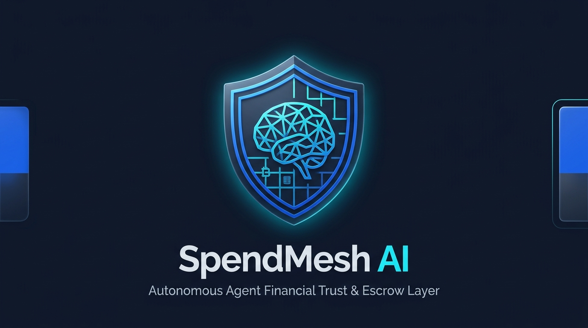
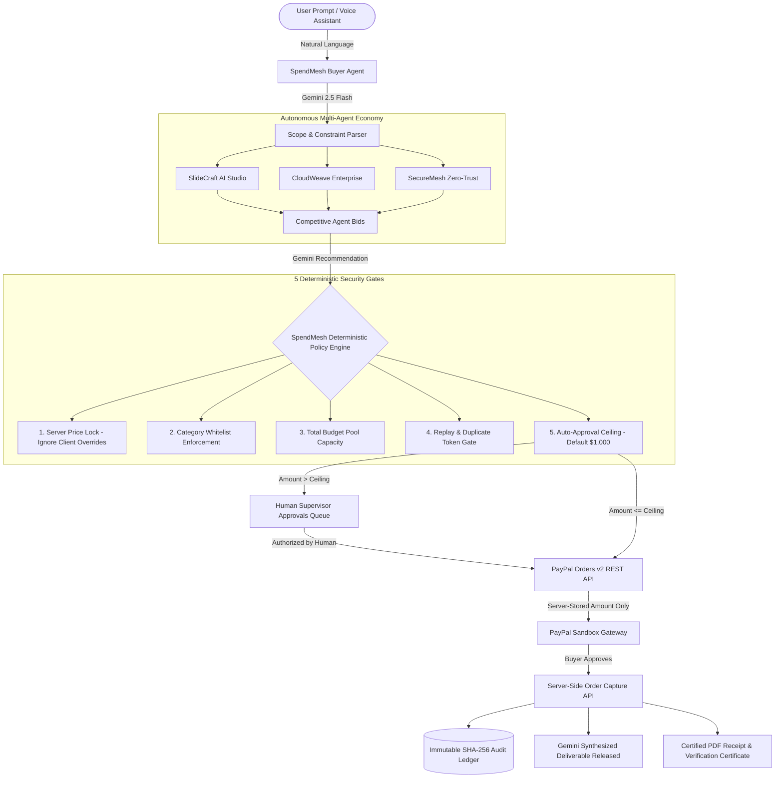

# SpendMesh AI

<div align="center">



### Autonomous Agent Financial Trust Layer & Escrow Gateway
**Enforcing deterministic spending policies and zero-trust safeguards between autonomous AI agents and PayPal payment rails.**

[](#automated-testing)
[](#automated-testing)
[](https://nodejs.org)
[](https://developer.paypal.com)
[](https://aistudio.google.com)
[](LICENSE)

[**Live Web App**](https://spendmesh-ai.vercel.app) • [**Backend API**](https://spendmesh-ai-api.onrender.com) • [**Health Probe**](https://spendmesh-ai-api.onrender.com/api/health)

</div>

---

## 1. Executive Summary

As autonomous AI agents evolve from passive conversational bots into active economic agents capable of hiring contractors, purchasing microservices, and provisioning infrastructure, a critical security barrier emerges: **How can organizations grant purchasing autonomy to AI agents without granting them unconstrained access to financial accounts?**

Giving an autonomous agent direct API access or credit card credentials introduces severe corporate vulnerabilities:
- **Hallucination Risk:** Non-deterministic LLM behavior can trigger runaway bids and unauthorized multi-thousand-dollar transactions.
- **Price Injection Attacks:** Malicious actors or compromised seller agents can manipulate payload parameters during checkout.
- **Runaway Loop Spending:** Infinite loops or cascading multi-agent task delegations can drain treasury reserves in seconds.

**SpendMesh AI** solves this fundamental challenge. It serves as an immutable, zero-trust financial policy perimeter between autonomous agent negotiation and payment execution. Every agent request is intercepted, evaluated through deterministic financial guardrails, settled via authentic **PayPal Orders v2 Sandbox**, recorded into a cryptographic SHA-256 audit ledger, and gated until delivery is verified.

---

## 2. Key Capabilities & Architectural Highlights

- **Deterministic Financial Guardrails:** Mathematical policy verification that cannot be bypassed by LLM hallucinations or prompt injection.
- **PayPal Orders v2 Sandbox Integration:** Server-side OAuth2 token generation, session initialization with server-stored amounts, and atomic order capture.
- **Server-Side Price Locking:** Discards any browser-injected price overrides (`400 Bad Request` or forced server lock). PayPal checkouts strictly bind to immutable server deal records.
- **Human-in-the-Loop Escalation:** Purchases exceeding the autonomous threshold (e.g., >$1,000) are automatically quarantined into a supervisor Approvals Queue.
- **Replay & Double-Capture Defense:** Enforces strict idempotency. Attempting to replay captured tokens halts with `HTTP 409 Conflict`.
- **Google Gemini 2.5 Multi-Agent Economy:** A buyer agent routes requirements to specialized seller agents (SlideCraft, CloudWeave, SecureMesh) and ranks multi-bid auctions.
- **Post-Payment Delivery Gating:** High-value deliverables (slide decks, architecture specs, security audits) remain encrypted/gated until verified PayPal capture.
- **Cryptographic Audit Ledger:** Every state change, policy decision, and capture is logged with SHA-256 hash chains for tamper-evident compliance.
- **Certified PDF & Printable Receipts:** Generates official compliance receipts with digital integrity hashes and instant print support.
- **Hands-Free Voice Assistant:** Web Speech API and neural audio guidance enable real-time voice-driven procurement and policy monitoring.

---

## 3. System Architecture



---

## 4. PayPal Orders v2 Sandbox Integration Deep Dive

SpendMesh AI utilizes official PayPal Orders v2 REST APIs with strict server-to-server security standards:

| Step | API Route | Implementation Details |
|---|---|---|
| **1. OAuth2 Authentication** | `POST /v1/oauth2/token` | Generates short-lived bearer tokens using PayPal Client ID & Secret over TLS. |
| **2. Secure Order Creation** | `POST /v2/checkout/orders` | Initiates checkout session with `intent: "CAPTURE"`. **Crucial Invariant:** The transaction amount is queried directly from the verified MongoDB deal record—never accepted from client requests. |
| **3. Atomic Capture** | `POST /v2/checkout/orders/{id}/capture` | Captures authorized funds upon return from the PayPal approval window. |
| **4. Replay Defense** | Database Transaction | Checks if deal status is already `payment_completed`. Prevents double-debiting with atomic `$expr` balance updates and `HTTP 409 Conflict`. |
| **5. Deliverable Unlocking** | Server State Gate | Synthesizes and releases the premium AI artifact *only* after `capture.status === 'COMPLETED'`. |

---

## 5. Live Production Deployments

- **Frontend Application (Vercel):** [https://spendmesh-ai.vercel.app](https://spendmesh-ai.vercel.app)
- **Backend API (Render):** [https://spendmesh-ai-api.onrender.com](https://spendmesh-ai-api.onrender.com)
- **API Health Check Probe:** [https://spendmesh-ai-api.onrender.com/api/health](https://spendmesh-ai-api.onrender.com/api/health)

---

## 6. PayPal Sandbox Demo Credentials

When completing test checkouts on PayPal's sandbox gateway, you may use your personal developer sandbox credentials:

- **Buyer Test Account:** `sb-buyer@business.example.com` *(or any Sandbox Personal Account from developer.paypal.com)*
- **Buyer Test Password:** *(Found in your PayPal Developer Dashboard > Testing Tools > Sandbox Accounts)*

> **Safe Testing Environment:** All transactions execute exclusively within the PayPal Developer Sandbox environment. No real funds or live financial accounts are charged.

---

## 7. Interactive One-Click Test Scenarios (on `/requests`)

To enable rapid, deterministic evaluation during judging, the application includes 4 interactive testing scenarios at the top of the **Purchase Requests** page:

| Scenario | Simulated Action | Expected Result |
|---|---|---|
| **1. Standard Purchase ($400)** | Gemini extracts scope &rarr; 3 seller bids evaluated &rarr; within $1,000 ceiling. | Auto-approved &rarr; genuine PayPal Sandbox checkout &rarr; artifact unlocked & certified receipt downloadable. |
| **2. Price Tampering Attack** | Simulates a compromised client injecting `{ amount: 800 }` on a $400 deal. | Server detects parameter deviation, flags tamper alert, discards override, and enforces authentic $400 order. |
| **3. Human Approval Gate ($2,000)** | Requests full-stack enterprise architecture bids exceeding the $1,000 auto-ceiling. | Policy engine flags `APPROVAL_REQUIRED`, quarantines deal to `/approvals`, blocking PayPal checkout until human sign-off. |
| **4. Duplicate Replay Attack** | Attempts to replay payment capture on an already-settled deal token. | Server halts execution with `HTTP 409 Conflict`, recording a `duplicate_blocked` audit event without balance deduction. |

---

## 8. Technology Stack

| Layer | Technologies | Purpose |
|---|---|---|
| **Frontend UI** | React 18, Vite 5, Tailwind CSS | Enterprise-grade responsive fintech interface |
| **Design System** | Custom SVG Design System (`Logo.jsx`, `favicon.svg`) | Cohesive, high-trust fintech branding (Stripe/Mercury style) |
| **Backend API** | Node.js (v20+), Express 5, Helmet, CORS | Zero-trust API gateway with request sanitization |
| **Database** | MongoDB Atlas, Mongoose | Atomic operations (`$inc`, `$expr`) for race-free balance allocation |
| **AI / LLM** | Google Gemini 2.5 Flash (`@google/generative-ai`) | Structured requirement extraction, bid ranking, deliverable synthesis |
| **Payment Rail** | PayPal REST API (Orders v2 Sandbox) | Server-to-server OAuth2 order creation & verified capture |
| **Receipts & PDF** | jsPDF, HTML-to-Canvas, Web Print API | Certified tamper-evident PDF receipts with SHA-256 integrity hashes |
| **Voice Engine** | Web Speech API, Web Audio Synthesizer | Natural voice narration, speech recognition, and acoustic feedback |
| **Automated Tests** | Jest, Supertest | 26 unit & integration tests covering policy, payments, deals, and agents |

---

## 9. Local Setup Instructions

### Prerequisites
- Node.js version 20.0.0 or higher
- npm version 10.0.0 or higher
- A free MongoDB Atlas cluster ([mongodb.com/atlas](https://www.mongodb.com/atlas))
- A PayPal Developer account ([developer.paypal.com](https://developer.paypal.com))
- A Google Gemini API key ([aistudio.google.com](https://aistudio.google.com))

### Installation Steps

1. **Clone the repository:**
   ```bash
   git clone https://github.com/Vinayak1806/Pay-Pal-Hackathon.git
   cd Pay-Pal-Hackathon
   ```

2. **Install all dependencies:**
   ```bash
   npm run install:all
   ```

3. **Configure Server Environment:**
   Copy `server/.env.example` to `server/.env`:
   ```bash
   cp server/.env.example server/.env
   ```
   Populate your credentials:
   ```env
   PORT=5000
   MONGODB_URI=mongodb+srv://<user>:<password>@cluster0.mongodb.net/spendmesh?retryWrites=true&w=majority
   PAYPAL_CLIENT_ID=your_paypal_sandbox_client_id
   PAYPAL_CLIENT_SECRET=your_paypal_sandbox_client_secret
   PAYPAL_BASE_URL=https://api-m.sandbox.paypal.com
   GEMINI_API_KEY=your_gemini_api_key
   GEMINI_MODEL=gemini-2.5-flash
   CLIENT_URL=http://localhost:5173
   ```

4. **Configure Client Environment:**
   Copy `client/.env.example` to `client/.env`:
   ```bash
   cp client/.env.example client/.env
   ```
   Contents:
   ```env
   VITE_API_URL=http://localhost:5000
   ```

5. **Start Development Servers (Frontend & Backend):**
   ```bash
   npm run dev
   ```
   - Client will run on: `http://localhost:5173`
   - Server will run on: `http://localhost:5000`

---

## 10. Automated Testing

The repository includes a comprehensive automated test suite validating deterministic policy rules, PayPal capture flows, and multi-agent solicitations.

Run tests from the root directory:
```bash
npm test
```

Or directly inside the server directory:
```bash
cd server && npx jest --forceExit --detectOpenHandles
```

### Verified Test Results
```text
PASS tests/payments.test.js
PASS tests/deals.test.js
PASS tests/agents.test.js
PASS tests/policy.test.js

Test Suites: 4 passed, 4 total
Tests:       26 passed, 26 total
Snapshots:   0 total
Time:        0.849 s
Ran all test suites.
```

---

## 11. API Endpoint Reference

| Method | Endpoint | Description |
|---|---|---|
| `GET` | `/api/health` | Health probe for deployment keep-alive monitoring |
| `POST` | `/api/agents/request` | Analyzes natural language prompt and solicits competing seller agent bids |
| `POST` | `/api/deals` | Validates selected offer and evaluates deterministic spending policy |
| `GET` | `/api/deals` | Lists deals (supports status filtering) |
| `GET` | `/api/deals/:id` | Fetches details and delivery state of a specific deal |
| `POST` | `/api/deals/:id/approve` | Approves or rejects an escalated purchase from the Approvals Queue |
| `POST` | `/api/deals/:id/checkout` | Creates PayPal Orders v2 session using server-stored amount |
| `POST` | `/api/payments/:orderId/capture` | Captures PayPal order and releases synthesized deliverable |
| `GET` | `/api/payments/cancel-status` | Restores reserved balance if user cancels PayPal window |
| `GET` | `/api/policy` | Fetches live treasury reservoir and spending parameters |
| `PUT` | `/api/policy` | Updates auto-approval limits, budget pool, or category whitelist |
| `GET` | `/api/audit` | Retrieves cryptographic SHA-256 audit log records |
| `GET` | `/api/audit/verify` | Verifies tamper-free integrity of the cryptographic Merkle chain |
| `POST` | `/api/demo/reset` | Resets demo collections and restores $5,000 treasury allocation |

---

## 12. Deployment Guide

### Frontend Deployment (Vercel)
1. Import repository on [Vercel](https://vercel.com).
2. Configure settings:
   - **Framework Preset:** Vite
   - **Root Directory:** `client`
   - **Build Command:** `npm run build`
   - **Output Directory:** `dist`
3. Set Environment Variable:
   - `VITE_API_URL`: Your deployed backend API URL (e.g., `https://spendmesh-ai-api.onrender.com`)

### Backend Deployment (Render)
1. Create a new Web Service on [Render](https://render.com).
2. Configure settings:
   - **Root Directory:** `server`
   - **Environment:** `Node`
   - **Build Command:** `npm install`
   - **Start Command:** `node src/app.js`
3. Configure Environment Variables (`MONGODB_URI`, `PAYPAL_CLIENT_ID`, `PAYPAL_CLIENT_SECRET`, `PAYPAL_BASE_URL`, `GEMINI_API_KEY`, `CLIENT_URL`).
4. Set up a free 10-minute keep-warm cron job at [cron-job.org](https://cron-job.org) pinging `/api/health` to prevent idle spin-down.

---

## 13. Sponsor Tools Attribution

- **PayPal:** Powers authentic escrow checkout and settlement via PayPal Orders v2 REST API (Sandbox).
- **Google Gemini:** Powers natural language requirement extraction, multi-agent bid ranking, and high-value deliverable synthesis via Gemini 2.5 Flash.

---

## 14. License

Released under the [MIT License](LICENSE). Copyright &copy; 2026 Vinayak Santosh Pawate.
